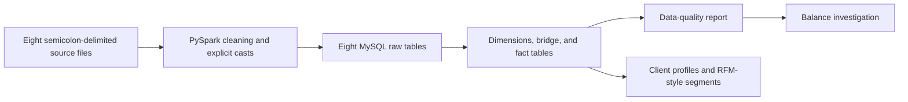
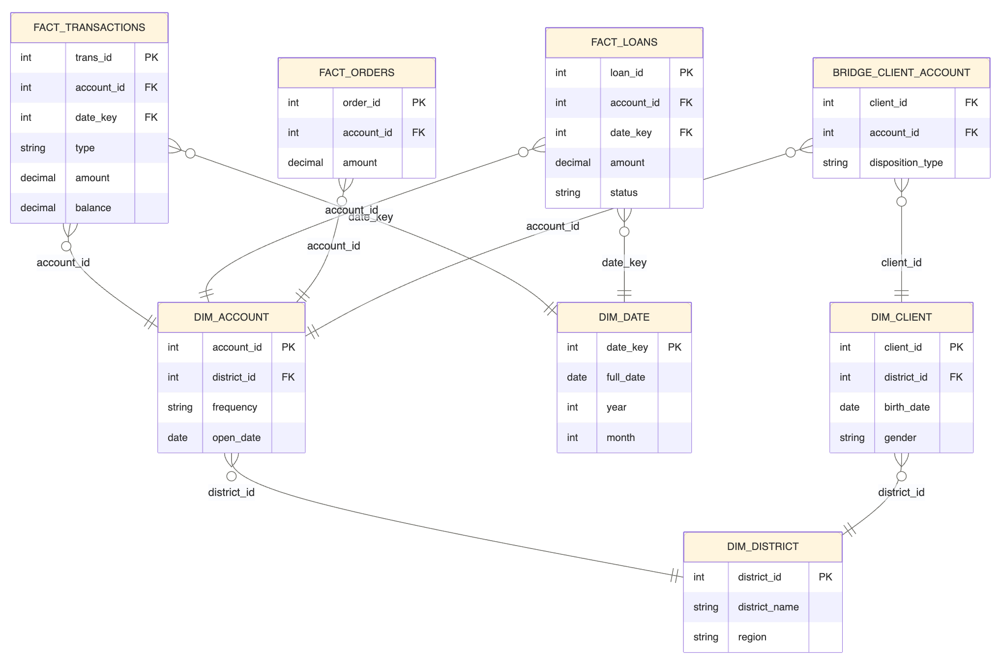

# Berka Banking Data: Modeling, Validation & Client Analytics

A data engineering project that transforms the historical Berka banking  
dataset into a relational analytical model using **Python, PySpark, SQL, and MySQL**.
It demonstrates source cleaning, dimensional modeling, explicit data-quality
checks, investigation of balance mismatches, and exploratory client segmentation.

The source contains **1,056,320 transactions**, **4,500 accounts**, and
**5,369 clients**. These counts were confirmed against the local source files on
2026-11-01; they describe dataset size, not a performance benchmark.

## Start here

- [Case study](docs/CASE_STUDY.md): problem, implementation, findings, and limitations.
- [Data model](docs/DATA_MODEL.md): table grains, relationships, and design choices.
- [Validation and evidence](docs/VALIDATION.md): what is checked and what was verified.
- [Setup guide](docs/SETUP.md): source files, environment, database, and notebook order.

## What this project demonstrates

| Capability | Implementation to inspect |
| --- | --- |
| Configuration-driven ingestion of eight source tables | [Cleaning notebook](notebooks/01_load_and_clean.ipynb), [table mappings](src/table_configs.py) |
| Four dimensions, a client-account bridge, and three fact tables | [Model notebook](notebooks/02_build_star_schema.ipynb), [SQL DDL](scripts/tables_trx_data_model.sql) |
| 28 model-quality result rows plus eight raw-table count comparisons | [Validation notebook](notebooks/03_validation.ipynb), [check functions](src/validations.py) |
| Investigation of transaction ordering and cumulative balance differences | [Investigation notebook](notebooks/04_investigation_balance_mismatch.ipynb) |
| Owner-attributed features and exploratory RFM-style segmentation | [Analytics notebook](notebooks/05_client_behavior_analysis.ipynb), [feature functions](src/client_analytics.py) |
| Focused automated checks for cleaning and configuration | [10 pytest tests](tests/README.md) |

## Pipeline and model





The diagram is a simplified overview. The [SQL DDL](scripts/tables_trx_data_model.sql)
defines the complete columns and constraints, including the bridge's composite
primary key. District attributes are shared through client and account dimensions.

## Evidence and current status

- All **10 existing unit tests passed** during the documentation review on
2026-11-01. They cover cleaning and table configuration, not the entire pipeline.
- Source-file counts matched all eight expected counts.
- The committed notebooks contain code and narrative but **no saved execution
outputs**. The local MySQL endpoint was unavailable during this review, so no
fresh end-to-end run or balance-reconciliation result is claimed.
- Earlier project notes report that interest-first ordering reduced balance
mismatches but did not eliminate them. The remaining differences and the
source-system explanation are discussed with their evidence limits in the
[case study](docs/CASE_STUDY.md).

This is a local portfolio sandbox using historical public data. It does not claim
production deployment, credit-risk prediction, or measured commercial impact.

## Run locally

Follow the [setup guide](docs/SETUP.md) before loading data. The project needs a
Python environment, Java, MySQL, and a MySQL Connector/J JAR. The full dependency
snapshot is in [requirements.txt](requirements.txt).

After installing dependencies, run the database-independent tests from the root:

```bash
python -m pytest -q
```

Run notebooks `01` and `02` once against empty tables, then `03` through `05`.
Loads append to tables and are **not idempotent**; rerunning them can fail on
duplicate primary keys or leave a partially loaded pipeline.

## Repository guide

| Directory | Contents |
| --- | --- |
| [notebooks/](notebooks/README.md) | Five ordered workflow notebooks |
| [src/](src/README.md) | Reusable configuration, transformation, validation, and analytics functions |
| [scripts/](scripts/README.md) | Raw-layer and analytical-model SQL DDL |
| [tests/](tests/README.md) | Existing unit tests and coverage boundaries |
| [docs/](docs/CASE_STUDY.md) | Case study, setup, data model, validation evidence, and ERD |

## Data attribution and reuse

The Berka dataset originates from the **PKDD'99 Discovery Challenge**. This
project references the distribution maintained at
[jlacko/berka-dataset](https://github.com/jlacko/berka-dataset).
The dataset is external input; the modeling and validation workflow is the work
demonstrated here. Raw data, credentials, and JDBC binaries are excluded from Git.

No project software license is currently included. Dataset provenance and
permissions must be considered separately from any future software license.
