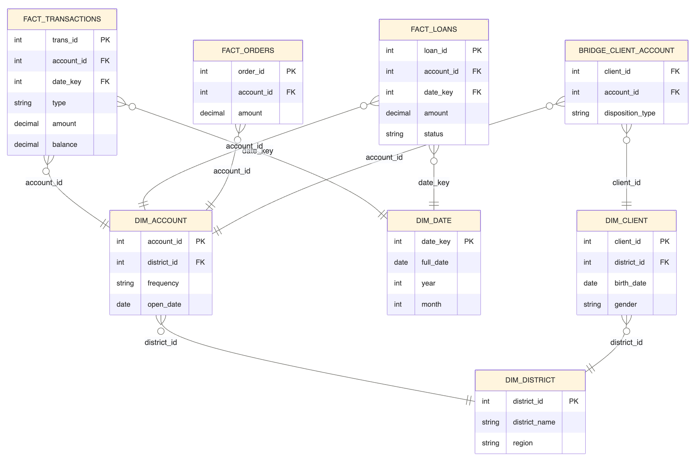

# Analytical data model

The model contains four dimensions, a client-account bridge, and three fact
tables. It uses source identifiers rather than generated surrogate keys and has
no slowly changing dimension history. District attributes are normalized behind
client and account dimensions, so the design includes snowflaked relationships
rather than a completely denormalized star.

This image shows selected fields and relationships. It omits some physical
columns and does not label the bridge composite primary key. The authoritative
schema is [`tables_trx_data_model.sql`](../scripts/tables_trx_data_model.sql).

## Table grains and keys

| Table | One row represents | Primary key | Main relationships / measures |
| --- | --- | --- | --- |
| `dim_date` | A calendar day, 1993-01-01 through 1998-12-31 | `date_key` (`YYYYMMDD`) | 2,191 generated days; year, quarter, month, weekday, weekend |
| `dim_district` | A source district | `district_id` | Demographic and economic attributes; nullable historical indicators |
| `dim_client` | A source client | `client_id` | District FK; decoded birth date and source gender code |
| `dim_account` | A source account | `account_id` | District FK; opening date and statement frequency |
| `bridge_client_account` | A client-account association | (`client_id`, `account_id`) | Client/account FKs and `OWNER` or `DISPONENT` disposition |
| `fact_transactions` | A source transaction posting | `trans_id` | Account/date FKs; amount and stated post-transaction balance |
| `fact_loans` | A source loan | `loan_id` | Account/date FKs; principal, duration, payments, status |
| `fact_orders` | A standing payment order | `order_id` | Account FK; scheduled amount and counterparty details |

The bridge supports client-account associations without placing a client ID on
every fact. The composite key permits only one row per client-account pair.
The DDL does not independently enforce exactly one `OWNER` per account; analyses
must verify their attribution assumptions.

## Measures and aggregation rules

- Transaction `amount` is stored as a non-signed source amount. Analytics treat
  `PRIJEM` as positive and all other types as negative after a separate type-domain
  check. Amounts use `DECIMAL(12,2)` in MySQL.
- Transaction `balance` is an account state after a posting. Summing balances
  across transactions is not a meaningful flow measure. Choosing an end-of-day
  balance requires an ordering rule that the source does not fully establish.
- `fact_orders` describes standing instructions, not executed transactions. Do not
  add its amounts to transaction totals as if they were separate cash movements.
- Loan amounts and payment schedules describe loans, not observed repayments.
- Monetary values retain the source units; the model has no currency-conversion
  logic.

## Transformations and boundaries

Raw dates remain `CHAR(6)` until notebook `02` prefixes `19` and parses them.
The date parser is specific to this historical dataset. Client birth dates can
predate the transaction calendar and are stored directly in `dim_client`.
Birth-number decoding reverses the source's female-month offset of 50; it does
not validate every possible malformed identifier.

The raw `card` table is loaded and counted but has no dedicated card dimension or
fact in this model. The raw layer preserves counterparty information that is not
fully retained in `fact_transactions`. The bridge drops the source `disp_id` in
favor of the client-account composite key.

Foreign keys and indexes are declared in MySQL, while notebook `03` repeats
selected integrity checks as explicit data-quality evidence. The notebook does
not test every constraint or business rule in the schema.
